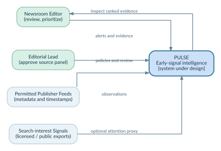
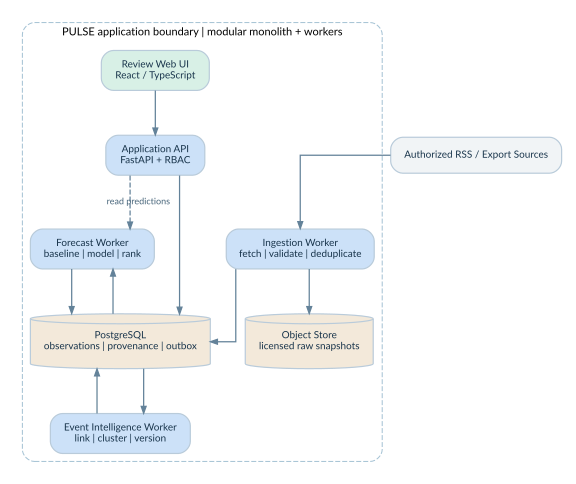
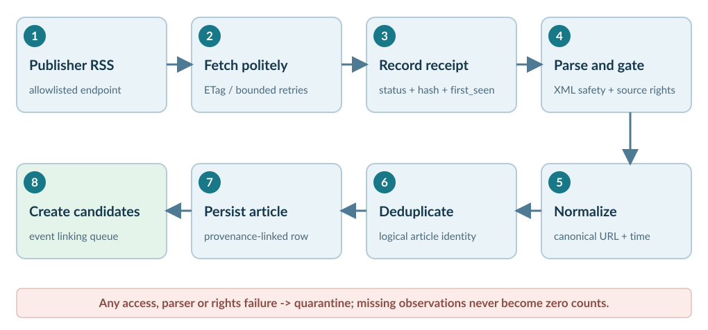
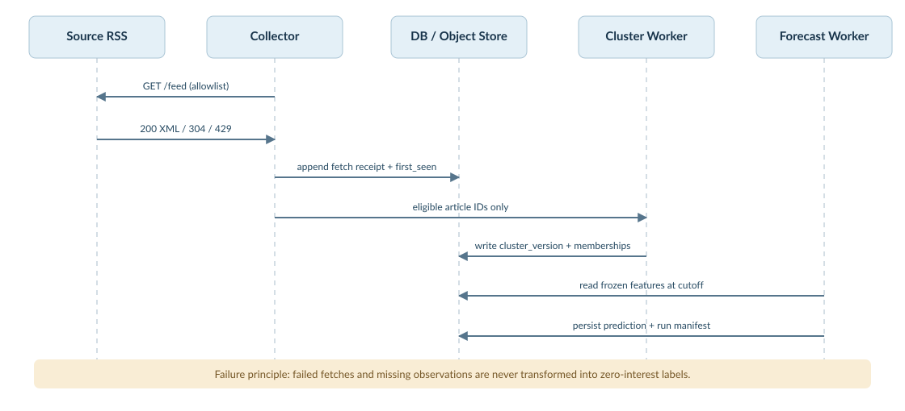
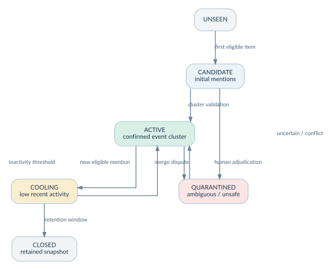
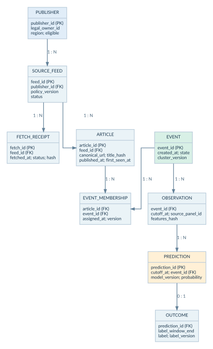
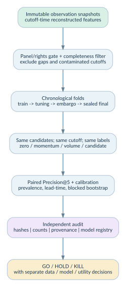
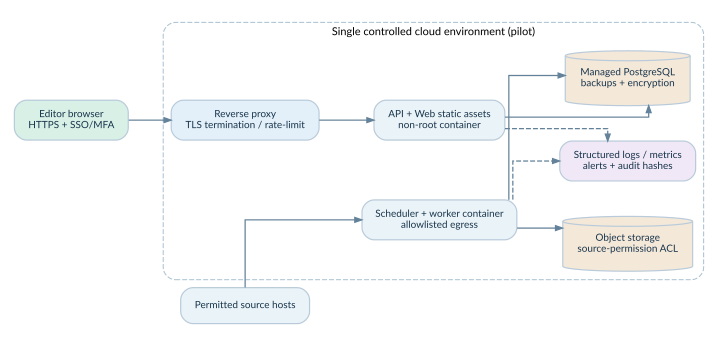
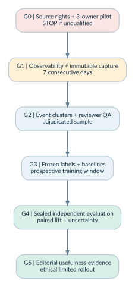

<div class="eyebrow">ENGINEERING DESIGN PROPOSAL / V0.1 / 12 OCT 2026</div>

# PULSE

## Saudi Editorial Early-Signal Intelligence

**Software Engineering Blueprint, Forecasting Research Protocol & Critical Review Dossier**

**Document status:** Design proposed; forecasting ability not validated  
**Intended readers:** Software architects, ML reviewers, newsroom operations, legal/data-governance reviewers, and hackathon technical judges  
**Decision requested:** Approve a controlled data-feasibility pilot, **not** a production forecast rollout

<div class="statusline"><span>TECHNICAL READINESS: DESIGN</span><span>DATA FEASIBILITY: HOLD</span><span>MODEL PERFORMANCE: UNKNOWN</span><span>CUSTOMER VALUE: UNTESTED</span></div>

> **Design principle.** An evidence-backed system that says “we do not know” is more valuable than a forecasting demo that silently treats missing coverage, stale feeds, or search popularity as measured public opinion.

<div class="pagebreak"></div>

## Executive decision / Reader's guide

PULSE is intended to help a Saudi newsroom identify **already-emerging news events** that may experience a material rise in audience attention before editors allocate full coverage. The longer-term product combines distinct signals: news coverage, public search interest, and optionally licensed public engagement. **These signals must not be confused.**

**What can be engineered first:** a rights-checked, prospective feed panel that timestamps article discovery, clusters mentions into events, and predicts whether **observed panel coverage** will surge within the next 24 hours. This is **not** equivalent to audience-interest forecasting. A public-attention model becomes a separate experiment when a legally available, continuous interest ground truth exists.

**Evidence available today (team-reported; not independently re-audited in this dossier):** Phase 1 obtained **0/540** planned GDELT cells due to HTTP 429, despite 43 software tests. Phase 1B recovered one Al Arabiya feed sample (30 items) and one Saudi Trends snapshot (10 selected queries), but no historical evaluation. Phase 1C recovered 50 distinct time-stamped Sabq entries, but **did not establish an eligible three-owner publisher panel**. All previous forecasting decisions remain **HOLD**. No prediction accuracy, confirmed editorial outcome, or willing customer is documented.

| Design decision | Chosen approach | Why / qualification |
|---|---|---|
| Core forecast horizon | 24 hours; cutoffs every 6 hours | Actionable daily planning, repeated prospective labels; not a proven optimum. |
| First measurable target | 24-hour **first-observed RSS-panel coverage surge** | Observable after eligible collection; narrower than popularity or opinion. |
| User output | Five ranked **editorial candidates** with citations and quality warnings | Assist human editorial review; do not automate publication. |
| Architecture | Modular monolith + isolated scheduled workers | Small team, transactional provenance, lower operating complexity. |
| ML strategy | Strong deterministic baselines first; trained model only after data gate | Avoid premature LLM-based prediction claims. |
| Research evidence | Prospective time-stamped snapshots and untouched final evaluation | Historical published dates alone cannot reconstruct what was available at decision time. |
| Commercial claim | Problem category has market evidence; product differentiation remains a hypothesis | Existing products already predict article engagement [R1]. |

**Out of scope for MVP:** detecting never-before-seen future events; measuring Saudi resident opinion from social/search traces; changing or manipulating public attitudes; automatic news publication; individual political profiling; scraping forbidden or private sources; claiming an independently verified proprietary forecasting edge.

### Document map

01 Problem & system boundary · 02 stakeholders and requirements · 03 architecture · 04 ingestion and legal provenance · 05 event intelligence and data model · 06 prediction specification · 07 evaluation and anti-leakage · 08 editorial output and APIs · 09 deployment, security and tests · 10 delivery plan, risks and critical questions · references.


## 01 / Problem definition and hypothesis structure

### 1.1 Problem statement

An editor has finite reporting capacity while relevant stories emerge unevenly across publishers and attention channels. Existing dashboards frequently reveal what is already visible; PULSE investigates whether timestamped multi-source signals can **rank emerging event candidates earlier** and provide defensible supporting evidence. **Earlier** and **more useful** are testable hypotheses, not established outcomes.

### 1.2 Separate the three estimands

| Construct | Example observable | What it measures | What it does **not** measure |
|---|---|---|---|
| **C - Coverage** | Newly first-seen articles about event *e* in a verified publisher panel | Publication/discovery activity within the enrolled panel | Entire Saudi media ecosystem; audience opinion. |
| **A - Attention** | Search trend data / licensed aggregate engagement | Specific platform/search-interest activity | Representative national attitudes or approval. |
| **O - Opinion** | Representative survey items with defined sampling frame | Responses of a specified sampled population | Search volume, article count, social sentiment by default. |

**MVP outcome:** Predict future **C** only. If **A** later becomes available, formulate a distinct prediction task with separate labels, calibrations and reports. Study **O** only through defensible public-opinion research; Google states explicitly that Trends is **not a scientific poll** [R2].

### 1.3 Testable hypotheses

- **H-DATA:** At least three independently owned Saudi-relevant publishers permit prospective metadata retention, publish current timestamped feeds, and support low-gap 24-hour observations. Previous phases have **not** confirmed this.
- **H-CLUSTER:** Event-level grouping meaningfully outperforms broad topical baskets in human-adjudicated precision while preserving time-causal membership.
- **H-PRED:** A pre-registered candidate beats the best simple baseline on paired, untouched 24-hour surge ranking after uncertainty estimation.
- **H-UTILITY:** Independent newsroom-style evaluation finds earlier and more useful editorial candidates than manual scanning of the same evidence. This has **not** been measured.

### 1.4 Success is conjunctive

A model can be accurate but useless, or useful in a demo without being honest about data coverage. Production GO requires independent passes on **source permission**, **continuous data completeness**, **prediction value**, **operational reliability**, and **editorial utility**. A HOLD on any blocking gate cannot be overridden by UI quality or high unit-test counts.


## 02 / Stakeholders, use cases and requirements

### 2.1 Stakeholder and permission model

| Role | Primary need | Authorized action |
|---|---|---|
| Duty editor | Compare candidates with clear reasons | View candidates, mark useful/not useful, open evidence. |
| Managing editor | Allocate assignments and set beat preferences | Review quality stats and approved configurations. |
| Research / ML lead | Reproduce snapshots, labels and results | Create locked experiments; cannot rewrite prior snapshots. |
| Data steward / legal reviewer | Validate source rights and attribution | Approve or disable feeds; set retention and allowed uses. |
| Operator | Investigate failures, freshness and cost | See health metrics, restart workers; no editorial alteration. |
| Independent auditor | Reproduce outcomes without trusting dashboard | Read frozen exports, hashes and decision logs. |

### 2.2 Use cases (UC)

| ID | User intention | Primary path | Failure / alternate behavior |
|---|---|---|---|
| UC-01 | See emerging event candidates | Editor requests a cutoff; system ranks qualified events | Empty result with data-quality reason if panel incomplete. |
| UC-02 | Understand why event is highlighted | Open event card; inspect signal history, publisher count and citations | Unsupported indicators labeled unavailable. |
| UC-03 | Inspect forecast reliability | Show version, cutoff, panel health, calibration bucket | Suppress probability when model not released. |
| UC-04 | Register a publisher feed | Steward checks owner, feed terms, timestamps, robots/access scope | Fail closed: source is not enrolled. |
| UC-05 | Review incorrect event grouping | Editor flags merge/split; reviewer adjudicates | New version; no historical backfill into frozen features. |
| UC-06 | Reproduce historical decision | Auditor loads immutable cutoff snapshot + model/label manifests | If artifact missing, evaluation is blocked, not assumed zero. |

### 2.3 Functional requirements with acceptance criteria

| ID / priority | Requirement | Testable acceptance |
|---|---|---|
| FR-01 P0 | Source entitlement registry | Every fetch links to an active rights policy and distinct legal owner. |
| FR-02 P0 | First-observed ingestion | Each accepted item has `first_seen_at`, source, URL, and fetch receipt hash. |
| FR-03 P0 | Idempotent processing | Replaying same fetch causes no duplicate logical article. |
| FR-04 P0 | Event resolution | Reviewable event membership with model/version and merge audit trail. |
| FR-05 P0 | Time-causal feature snapshots | No feature timestamp is later than its prediction cutoff. |
| FR-06 P0 | Locked forecast run | Records panel, threshold, code, model and feature hashes. |
| FR-07 P0 | Baseline parity | Candidate and baselines see identical events and cutoff data. |
| FR-08 P1 | Evidence-first briefing | Top five candidates show citations, signal provenance and quality state. |
| FR-09 P1 | Feedback capture | Editor can rate usefulness with timestamp and anonymized context. |
| FR-10 P1 | Rights-driven deletion | Disallowed source data can be removed with deletion audit and downstream invalidation. |

### 2.4 Non-functional targets (design targets, **not measured SLAs**)

| Attribute | Pilot engineering target | Verification |
|---|---|---|
| Freshness | 95% of eligible feed checks within 30 min of schedule | Ingestion lag histogram per feed. |
| Data integrity | 100% evidence records linked to fetch receipt and permission record | Referential + hash audit. |
| Availability | 99% monthly availability for read-only pilot UI | Synthetic monitor; only after rollout. |
| Query responsiveness | P95 candidate list under 2 s with cached rankings | Load test with realistic dataset size. |
| Recoverability | RPO 24 h, RTO 4 h for pilot metadata | Backup-restore exercise. |
| Accessibility | Keyboard navigation and readable status labeling | WCAG-oriented manual + automated checks. |
| Reproducibility | Independent script reproduces all released metric denominators | Audit job with immutable manifests. |

Priority P0 means gate-blocking, not a commitment to meet the target immediately. Source count and freshness targets must be revised if actual feeds cannot support them.

<div class="pagebreak"></div>

## 03 / System architecture

### 3.1 C4 Level 1 - system context



*Figure 1. People and external evidence sources relative to the proposed PULSE system. Dashed or optional integrations do not imply that access is granted.*

**Architecture decision ADR-001:** choose a **modular monolith** with background workers instead of microservices. Distinct modules can have clear boundaries without deployment overhead. Split services only after measured throughput, team ownership or isolation needs justify it. The C4 approach is an architecture communication convention, not proof of implementation [R3].

### 3.2 C4 Level 2 - containers and ownership



*Figure 2. Proposed containers and storage flows. The database is the operational system of record; the object store retains raw receipts only where rights allow.*

| Module | Responsibility | Public contract |
|---|---|---|
| `source_registry` | Publisher owner, license, endpoints, retention and status | Enroll/disable/inspect source; review-only writes. |
| `ingestion` | Bounded fetch, receipts, XML parsing, canonicalization | `ArticleObserved` event, fetch health. |
| `event_intelligence` | Dedup, entity detection, event clustering, adjudication | Versioned membership and event state. |
| `feature_store` | Point-in-time aggregates and dataset snapshots | `snapshot(event, cutoff, panel_version)`. |
| `forecasting` | Baselines, future surge classification, ranked candidates | Immutable `PredictionRun` artifact. |
| `editorial` | Event evidence cards, audit trail, feedback | Read-only primary workflow. |
| `evaluation` | Labels, embargo splits, bootstrap, frozen test reports | Reproducible CLI, not editor-facing probability by default. |

**Technology choices (replaceable, not vendor requirements):** Python 3.12+, FastAPI/Pydantic, PostgreSQL, SQLAlchemy/Alembic, Python scheduled workers, object storage, React/TypeScript, scikit-learn/gradient-boosted trees. pgvector or an embedding service is optional only after baseline cluster rules are assessed. Redis / message broker is deferred until needed.

### 3.3 Logical data path



*Figure 3. Fail-closed ingestion. Network errors and missing observations become explicit quality states, never implicit zero-coverage observations.*

### 3.4 Dynamic behavior - initial observation to prediction



*Figure 4. UML-inspired sequence. The collector records what was known at that moment; downstream workers may never invent historical visibility retrospectively.*


## 04 / Data acquisition, rights and temporal provenance

### 4.1 Source eligibility is a release gate

A source is eligible only if an auditable **Source Manifest** includes: legal publishing owner; unique publisher ID; original live feed URL; publication locale and topical scope; permitted use/retention/training boundaries; attribution rule; current timestamp quality; access/rate limits; handling of redirects and republished items; monitoring approval; reviewer and approval date. Multiple feeds of the same legal owner count as **one** owner for the required panel.

**Panel minimum for a limited pilot:** at least **three** distinct owner-verified Saudi-relevant publishers with current content and permissible metadata use. This is an engineering proposal, not sufficient evidence of market representativeness. The prior 1C attempt did not meet it. Increase diversity for serious inference; keep exact panel membership fixed during an evaluation run.

| Source class | Use if approved | Key caveat / blocker |
|---|---|---|
| Original publisher RSS | Prospective publication/discovery events | Feed freshness, legal owner and retention rights. |
| Media Cloud archive | Ancillary historical coverage / discovery | Requires access review; date-only archive not an as-of snapshot [R4]. |
| GDELT timelines | External context / optional retrospective analysis | Prior 429 blocker; normalization semantics and retrospective revisions [R5]. |
| Google Trends RSS/export | Separate aggregate search-interest context | Not a representative poll; export availability does not guarantee historical replay [R2, R6]. |
| Licensed social data | Future public-engagement signal | Platform contract, geography, bot/spam bias and retention. |

**Respect access restrictions:** allowlisted hosts; documented crawl intensity; conditional HTTP requests; explicit `429` circuit breaker; no rotating proxies or evasive scraping. Publication metadata may be used only within the verified terms. Full-text storage and model training are **off by default**. Independently verify any publisher's terms before use.

### 4.2 Point-in-time semantics

For every article preserve `published_at` (**publisher claim**) and `first_seen_at` (**our collector's actual first observation**) in UTC. These timestamps are not interchangeable. For an evaluation at cutoff **t**, inputs are eligible only if observed by t and retrievable from an immutable state snapshot at t.

**Why this matters:** An article published at 10:00 but first seen at 13:00 cannot legitimately influence a prediction issued at 11:00. RSS histories accessed later cannot recreate the 11:00 world. Dataset versions must include source-panel membership, original fetch receipts, and parser/normalization versions.

### 4.3 Operational collector rules

1. Poll within allowed source cadence; save ETag, Last-Modified, status code and fetch time.
2. Store bounded raw bytes and SHA-256 only where source permissions allow; otherwise store policy-permitted metadata and failure receipts.
3. Reject oversized, malformed or external-entity XML; block redirects to non-allowlisted/internal IPs.
4. Normalize canonical URLs, timezone, language tag and publication precision; retain raw field hash to inspect transforms.
5. Deduplicate item updates without rewriting `first_seen_at`; preserve edits as versioned observations.
6. Propagate feed degradation into `panel_health`, prediction eligibility and evaluation denominators.

### 4.4 Failure / gap taxonomy

| Condition | Recorded state | Scoring consequence |
|---|---|---|
| 200 and current valid feed | `OK` | Data eligible after rights gate. |
| 304, valid cached state | `NO_CHANGE` | Eligible if freshness window still valid. |
| 429 / 503 / timeout | `RATE_LIMITED` / `UNAVAILABLE` | Missing interval; not zero coverage. |
| Malformed timestamp / stale archival feed | `INVALID_TIME` / `STALE` | Quarantine affected items. |
| License unknown or withdrawn | `RIGHTS_BLOCKED` | Stop ingestion; invalidate dependent experiments. |
| Owner relationship unverified | `OWNER_UNVERIFIED` | Do not count toward independent panel. |


## 05 / Event understanding and data model

### 5.1 Events, not keywords

A broad basket such as “economy” mixes unrelated events and causes unstable denominators. PULSE should represent an **event** as a time-local story centered on a coherent action/development, participants/entities, location, and source evidence (e.g., a particular transport fare decision rather than “transport”). The LLM, if used, may propose descriptions, but **cannot define hidden labels or invent additional sources**.

**Candidate pipeline:** title normalization -> exact/near duplicate filtering -> entity and date extraction -> multilingual/Arabic semantic retrieval -> constrained pairwise matching -> provisional cluster -> periodic human review. Compare lexical TF-IDF+entity heuristics against embeddings before selecting a costly model. Use topic drift and split/merge events as explicit test categories.

### 5.2 State machine



*Figure 5. A reviewable state machine. State changes are append-only events; ambiguous merges are quarantined rather than silently rewriting prior prediction contexts.*

**Leakage rule:** An event's membership at time t is frozen for any prediction at t. If articles arriving at t+6 hours prompt a better cluster interpretation, it creates **version t+6**, not a rewrite of the earlier feature set. A deterministic frozen matching rule may assign future articles to an event for outcome measurement, but must not re-fit on future articles or modify the old event definition.

### 5.3 Domain model / ERD



*Figure 6. Essential normalized entities. Additional cross-cutting tables (rights policies, immutable experiment manifests, editor feedback, deletion jobs and access logs) are required but omitted to keep the diagram readable.*

**Required unique keys:** (`feed_id`, `canonical_url_hash`) for logical article identity; (`event_id`, `article_id`, `cluster_version`) for membership; (`event_id`, `cutoff_at`, `panel_version`, `features_hash`) for one immutable observation; (`event_id`, `cutoff_at`, `model_version`, `experiment_id`) for predictions. Deletion/invalidation events preserve a non-content audit record where legally permitted.


## 06 / Prediction specification (technical contract)

### 6.1 Scope of a valid forecast

At UTC cutoff **t**, for an **already-detected candidate event e**, estimate whether its source-panel coverage will exhibit a **surge during (t, t+24h]**, using only data observed at or before t. Schedule predictions every **6 hours**. Do not forecast unknown future event identities or claim that source counts indicate a survey-based opinion shift.

**Outcome at time t:** Let `N_future(e,t)` be the count of *newly first-observed*, non-duplicate eligible article records assigned by a **frozen membership rule** to event e during the next 24h. Let `B_future(e,t)` be distinct owner-verified publishers in those records. All counts are specific to a versioned source panel.

**Candidate label rule (to be finalized using training-only prevalence):** `surge=1` when `N_future` meets a pre-registered minimum absolute count **and** exceeds a panel-adjusted upper training quantile, while `B_future` exceeds a publisher-breadth floor; otherwise `surge=0` **only for complete observation windows**. If no permissible thresholds produce sufficient events, record **infeasible target**, not a manufactured benchmark. The historical phase's thresholds are frozen for its experiment and cannot silently be retuned under a different dataset.

### 6.2 Forecast objects

```
PredictionCandidate {
  event_id, cutoff_at_utc, horizon_hours: 24,
  target: 'PANEL_COVERAGE_SURGE', source_panel_version,
  cluster_version, feature_schema_version, model_version,
  forecast_probability: float | null,
  data_health: 'QUALIFIED' | 'DEGRADED' | 'BLOCKED',
  evidence_article_ids[], feature_manifest_sha256,
  explanation: {observed_volume, velocity, publisher_breadth}
}
```

If probability is `null`, the application must not backfill a fictional confidence percentage. Only observations may be shown with `status: OBSERVED_ONLY`.

### 6.3 Candidate features - all time-causal

| Feature group | Candidates | Failure modes |
|---|---|---|
| Momentum | First-observed items in 1h / 6h / 24h; velocity and acceleration | Feed outage mimics decay; boundary sampling biases. |
| Publisher breadth | Distinct legal owners and change in breadth | Common wire copies counted as independent voice. |
| Event novelty | First observed time, entity novelty vs last 14d | Clustering merges unrelated mentions. |
| Temporal context | Local hour, weekday, holiday or scheduled event flag | Overfitting calendar; “scheduled” != future newsroom uptake. |
| Search proxy (later) | Permitted export, timestamp and geographic scope | Normalized 0-100 scales; search interest != public opinion. |
| Quality metadata | Feed uptime, source count, parser confidence, coverage gaps | Leakage if future uptime contaminates features. |

### 6.4 Model ladder / ablations

**M0** no-skill / fixed-theme control; **M1** rank by last-6-hour item count; **M2** rank by six-hour growth (velocity) with volume floor; **M3** logistic regression or calibrated tree-based model; **M4** multi-signal model only after independent attention data qualifies. Run identical candidate sets at identical cutoffs. Use ML text summaries only for explanations, never as unverified forecasting evidence.

### 6.5 Ranking business logic

A calibrated surge probability (if validated) does **not** automatically imply editorial opportunity. Add separately transparent filters: event already covered by user's newsroom, source confidence, novelty, quality constraints and manually configurable beats. When public attention is unavailable, call output **Emerging Coverage Candidates**, not **Uncovered Public Demand**. Separate ranking from prediction so editors can see the effect of each policy choice.


## 07 / Research evaluation & leakage prevention

### 7.1 Experimental layout



*Figure 7. Data, experimental definitions, and scoring remain independently auditable. The locked 56-day final period is not consumed by pilot debugging.*

**Pre-registration:** publish `experiment.yaml` with panel owners, sampling cadence, forecast cutoffs, event-definition version, target label and quantile calibration method, eligible intervals, leakage guards, baselines, sample-size minimum, metric definitions and rejection criteria before evaluating the sealed final set.

**Time split (proposed):** initial setup/collector verification; a prospective development period long enough to estimate prevalence; rolling-origin validation with a 24h **label maturation delay**; untouched **56-day final period** per 1B plan. For an observation at t, its label matures no earlier than t+24h. Tuning must not use labels overlapping the future final interval. Expanding-fold validation is applicable only after equal-cadence observation and gap checks [R7].

### 7.2 What is measured

| Metric | Definition / rationale | Reporting condition |
|---|---|---|
| **Precision@5** primary | Per eligible cutoff, fraction of top 5 candidates confirmed surge | Include count of eligible cutoffs and total selections. |
| **Paired lift vs best baseline** | Candidate P@5 minus paired baseline P@5 at identical cutoffs | Report absolute percentage-point delta and uncertainty. |
| Recall@5 | Fraction of surging eligible events recovered in top five | Report event denominator, not just count of matches. |
| PR-AUC / Brier | Ranking and probability-calibration quality | Only when enough positives and calibrated probabilities exist. |
| Lead time | Hours between candidate alert and pre-defined surge confirmation | Only for true positives; report distribution and censoring. |
| Baseline prevalence | Eligible events surging / eligible candidate events | Required to interpret Precision@5. |
| Data completeness | Eligible intervals / scheduled intervals; by owner and time | Missingness is not encoded as negative examples. |

### 7.3 Evaluation statistical unit

Cutoffs every six hours are correlated. Do **not** pretend 56 days x 4 cutoffs x 5 picks are independent examples. Use **paired whole-day (or seven-day block) bootstrap** for uncertainty; retain incident-day diagnostics. Report confidence intervals and bootstrap distribution, not only the mean. Treat the 56-day final period as a **minimum intended holdout**, not guaranteed high statistical power; decide power only after positive-event prevalence is observed.

### 7.4 Contamination audits

- **T1:** Maximum feature first-seen time <= cutoff; prove from raw receipt chain.
- **T2:** Cluster-version timestamp <= cutoff for historical features; no retrospective future-guided merges.
- **T3:** Every prediction stores model binary digest and training-data manifest hash.
- **T4:** No model/threshold selection on the final test period; one planned opening.
- **T5:** Same denominator, event pool, complete windows, and cutoff schedule across M0-M3.
- **T6:** Revoked or stale feed invalidates window; blocked labels excluded with count.
- **T7:** Independent code reproduces input counts, P@5, bootstrap resampling seeds and audit locks.

**GO threshold is not pre-declared as “95% accuracy.”** Define an operational utility threshold before seeing results (e.g., minimum improvement over best baseline in P@5 plus acceptable false-alert burden), then report whether confidence bounds and practicality support it. If prevalence is too low for robust inference: **HOLD**, not a model-success announcement.


## 08 / Editorial decision workflow and API contracts

### 8.1 Human-in-the-loop product path

1. Editor opens “Next 24 Hours,” with explicit **last complete panel checkpoint**.
2. Candidate card shows exact event description, number of distinct publisher owners, links to source evidence, observed momentum, and any validated forecast probability.
3. Editor filters by beat and sees “already covered by our newsroom?” where manual or consented integration data exists.
4. Editor marks useful, duplicate, misleading, or not actionable. Ratings are research feedback, **not automatically used as a training label**.
5. A dashboard header shows source degradation; if qualified forecast cannot be issued, show only a timestamped **observed-signal** briefing.

**Accessibility / provenance rule:** No inaccessible “AI confidence” indicator or color-only warning. Show textual quality states. Every conclusion must be traceable to an allowed source URL and capture timestamp.

### 8.2 Example HTTP endpoints

| Verb/path | Purpose | Authorization |
|---|---|---|
| `GET /v1/candidates?cutoff=...&limit=5` | Ranked observed / forecast candidates, evidence and health | Editor (read) |
| `GET /v1/events/{id}/history` | Event cluster versions, linked articles and change history | Editor (read) |
| `GET /v1/sources/health` | Feed status and missingness for current source panel | Editor, operator |
| `POST /v1/feedback` | Validated editorial feedback with actor and timestamp | Editor |
| `POST /v1/sources/{id}/approve` | Enroll only after rights and owner review | Data steward |
| `GET /v1/experiments/{id}/manifest` | Immutable evaluation artifacts | Auditor |

**Sample truthful response before a model is validated:**

```json
{
  "status": "OBSERVED_ONLY",
  "as_of_utc": "2026-10-12T12:00:00Z",
  "forecast": null,
  "panel_health": "INCOMPLETE",
  "coverage_scope": "enrolled_feed_panel_only",
  "reason": "Independent-source gate not satisfied",
  "candidates": []
}
```

The sample above illustrates a **schema**, not an observed runtime result. API versioning uses additive fields first, strict typed response validation, request IDs, pagination and tenant-aware authorization for every resource. Idempotent write requests carry a key and audit actor.

### 8.3 Primary user stories & definition of done

| Story | Definition of done |
|---|---|
| As editor, I need why a topic is rising | Card shows cited mentions, cutoffs, distinct owner count and missing-data warnings; reviewer can reproduce evidence. |
| As editor, I need fewer false alerts | Ranking includes configurable suppression, backtest P@5, and an explicit alert budget. |
| As steward, I need sources used lawfully | Unapproved feed cannot be scheduled; disable action stops collection and triggers invalidation. |
| As auditor, I need to verify a claimed lift | Frozen final report includes exact sample counts, code revision, run ID and independently reproducible metrics. |


## 09 / Deployment, security and reliability engineering

### 9.1 Deployment view



*Figure 8. Small-scale pilot deployment. Logical trust boundaries are preserved even when all application processes run on one host.*

Suggested pilot setup: one controlled container host for API/UI/workers, managed or backed-up PostgreSQL, separate permission-controlled object storage, HTTPS reverse proxy, secret manager, scheduled workers and read-only observability. No message broker is needed unless queue depth or downtime recovery shows measurable pressure.

### 9.2 Trust boundaries and attack surfaces

| Threat | Control | Validation |
|---|---|---|
| SSRF through attacker-controlled feed URL / redirects | Host allowlist, DNS rebinding guards, reject private/link-local destinations | Automated malicious URL suite; egress restrictions. |
| XML bombs / hostile encoding | Disable DTD and entity expansion, document/item/timeout limits | Fuzz parser with known malicious inputs. |
| Prompt injection in news title/body | Treat retrieved text as untrusted data, separate instructions, sanitize tool outputs | Adversarial event-description fixtures. |
| Cross-tenant evidence access | Object-level RBAC, tenant scoping, deny-by-default | OWASP-oriented authorization tests [R8]. |
| Licensing violation or illicit retention | Policy-linked storage, expiry, deletion and training prohibition enforcement | Steward acceptance review and scheduled erasure tests. |
| Personal-data overcollection | Prefer aggregates and publication metadata; no per-person profiling | Data-minimization audit and documented DPIA/legal review if scope expands. |
| Deceptive editorial automation | No automatic publication, no targeted opinion manipulation, human review required | Workflow integration contract tests. |
| Overconfident forecasts under degraded feeds | Health gate suppresses predictions, auditable missingness | Chaos: 429, parser changes, multi-feed outage. |

**Governance:** Use the NIST AI RMF ideas of Govern, Map, Measure and Manage as a review checklist, not as a claim of NIST certification [R9]. Assess local law and publisher contracts before ingesting personal or copyrighted content. Web content is not a safe instruction source.

### 9.3 Operations, observability, reliability

**Metrics:** fetch success %, source-age by owner, HTTP 429 count, invalid timestamps, duplicates, event-cluster ambiguity, link health, point-in-time feature violations, eligible-cutoff coverage, daily prediction volume, request latency, storage spend and editorial false-alert feedback. Tag metrics by hashed source ID; avoid user identifiers in metric labels.

**Alerts:** multiple owner feeds unavailable; unknown rights status; observed panel below minimum; high duplicate-rate jump; `first_seen_at` clock skew; prediction issued with degraded input; hash mismatch; expired retention. **No silent fallback** from missing news inputs to LLM-synthesized “signals.”

**Resilience:** idempotent workers, exponential backoff respecting publisher limits, capped retries, circuit breaker for 429, dead-letter/quarantine store, periodic backup verification and documented source-wide failure mode. SLOs are targets to prove during rollout, not historical measurements.


## 10 / Verification strategy and software quality

### 10.1 Test pyramid and release controls

| Layer | What to test | Representative checks |
|---|---|---|
| Unit | URL canonicalization, time parsing, rights predicates, topic feature math | DST, missing fields, duplicate RSS GUID, malformed dates. |
| Property / fuzz | Parser and timestamp invariants | `first_seen_at` never decreases; no network metadata trust. |
| Integration | HTTP/RSS adapters, DB migration, replay, queue idempotency | 304/429, expired sources, same URL changed title. |
| Contract | Pydantic / OpenAPI outputs, provider fixtures | Schema drift, provenance field required, `forecast=null` on BLOCKED. |
| Security | SSRF, XML entities, ACLs, prompt injection, secrets | Private-host redirect refused; other tenant cannot read event. |
| Temporal | Point-in-time feature and label integrity | Future article never available to past cutoff. |
| Statistical | Null baselines, bootstrap pairing, calibration | Shuffled labels no artificial lift; count reproduction. |
| End-to-end | Source approval -> capture -> event -> observed card -> audit | Disabled source never appears; screenshot and a11y checks. |

### 10.2 CI/CD stages

`format/lint -> type check -> unit + property -> integration (offline fixtures) -> security scan -> build image -> SBOM -> staging migrations -> smoke test -> manual promotion`.

Every model release has a model card, feature schema lock, training-data manifest, reproducible evaluation artifact and rollback route to **observed-only** mode. Never release a trained model solely because tests pass; tests validate software behavior, not predictive usefulness.

### 10.3 Quality measurement

Measure functional correctness, performance, reliability, security, maintainability and usability with explicit acceptance evidence, taking ISO/IEC 25010:2023 as a *reference quality model*, not a formal certification claim [R10]. Include a reproducible independent audit script outside the feature-implementation package to detect shared implementation mistakes.


## 11 / Delivery plan: two clocks, explicit gates

**Clock A: hackathon concept / demonstrator (72 hours)** can validate experience and data constraints; it **cannot** validate 24-hour prediction lift without a legitimate historical or prospective dataset. **Clock B: scientific product validation (months)** starts only after source rights and observation panels are stable. These clocks must not be conflated.

### 11.1 Gated critical path



*Figure 9. Sequential gate dependency. A GO at one gate does not imply GO for the remaining system or business case.*

### 11.2 Work breakdown / phase deliverables

| Phase / tentative duration | Deliverable & engineering work | Gate to proceed |
|---|---|---|
| **A0 - 2–3 days** | Repo, ADRs, schemas, offline ingestion fixtures; source-rights evidence inventory | Every candidate source status unambiguous. |
| **A1 - 1–2 weeks** | Three-owner legal source panel; reliable RSS collector; receipts, retention, provenance | **G0:** independently owned, permitted, current feeds. |
| **A2 - 1–2 weeks** | Continuous collector, freshness dashboard, failure injection, restore drill | **G1:** minimum seven consecutive qualified observation days. |
| **A3 - 2–3 weeks** | Event clustering, human annotation set, membership-version invariants | **G2:** predefined review quality and ambiguity process. |
| **A4 - ~8–12+ weeks** | Prospective history, feature freeze, baselines, experimental design | **G3:** enough positives, negative controls and clean labels. |
| **A5 - 56 days untouched** | Sealed test, independent audit, blocked bootstrap, model card | **G4:** defensible lift, uncertainty and false-alert burden. |
| **A6 - 2–4 weeks** | Editorial walkthroughs / benchmark case review and measured decision outcomes | **G5:** usefulness evidence, permission and operational review. |

**Durations are engineering estimates, not a calendar commitment.** A4 and A5 could overlap prospective data collection only where strict training/final temporal separation is maintained; a 56-day sealed final window must remain untouched. If three-source gate is blocked, downstream forecasting delivery dates are undefined.

### 11.3 Hackathon-safe 72-hour deliverables

- Day 1: signed-off source feasibility register, architecture diagrams, schema/migrations, offline contract tests; decide if lawful live panel exists.
- Day 2: observational ingestion for eligible feeds only, immutable receipts, event clustering demonstration with cited *real* items and visible coverage limits.
- Day 3: evidence-first candidate briefing with honest quality indicators; frozen evaluation protocol; competitor comparison; future research milestones.

**If live source eligibility fails:** deliver a clickable **explicitly labeled synthetic UI prototype** and engineering research proposal; do not call it a functioning news forecast or embed fabricated accuracy charts.

### 11.4 Team model and interfaces (3 core contributors)

| Role | Owns | Must review |
|---|---|---|
| Backend / data engineering | Adapters, schema, ingestion/retention, API, deployment | source rights, point-in-time invariants and security. |
| Applied ML / research | clustering, baselines, labels, evaluation, model card | leakage, power, independent counts, confusion analysis. |
| Product / UI / design | evidence cards, workflows, accessibility and usability tests | truthfulness of labels, error states, uncertainty communication. |

Shared ownership: requirements, ADR review, CI rules, dataset entitlement decisions, demo claims. A person with source-rights authority and an independent metric reviewer are **additional external responsibilities** and cannot be presumed provided by the three-person core team.

### 11.5 Repository and release artifacts

```
pulse/
  docs/adr/                 # immutable rationale for architecture decisions
  contracts/                # OpenAPI, event schema, source manifest schema
  apps/api/                 # versioned HTTP interface
  apps/web/                 # editor workbench
  services/ingestion/       # licensed feed adapters and raw receipt audit
  services/events/          # clustering, deduplication, reviewer queue
  services/forecast/        # features, baselines, model inference
  research/protocols/       # frozen targets and pre-registrations
  research/evaluations/     # sealed outputs, negative controls, auditor
  infra/                    # Docker Compose / migrations / monitoring
  tests/                    # unit, integration, contracts, temporal, security
```

**Branch policy:** small PRs, two-person review for rights/model-target changes, migrations applied in CI, immutable release tag and audit manifest. A model publication must cite the exact source panel and test cutoff period.


## 12 / Risks, assumptions and adversarial critique

### 12.1 Risk register

| Risk / severity | Evidence or trigger | Mitigation / fallback | Owner |
|---|---|---|---|
| **R-01 critical: no eligible multi-owner panel** | Phase 1C three-owner gate failed | Stop predictive workflow; permission outreach; alternate licensed feed data | Data steward |
| **R-02 critical: target/public-value mismatch** | RSS records measure coverage, not audience interest | Name honest proxy; separate attention experiment | Product + ML |
| **R-03 critical: retrospective leakage** | Later article availability / clustering revisions | First-seen snapshots, time locks, independent audit | ML lead |
| R-04 high: rare positive surges | Low prevalence in collected panel | Reassess cohort/target; power analysis, no inflated accuracy | ML lead |
| R-05 high: publisher / syndication bias | Multiple feeds reuse one wire story | Owner + syndication dedup; publisher-breadth tests | Data lead |
| R-06 high: competitor parity | NewsWhip already forecasts 24h engagement [R1] | Test narrow unmet workflow, not generic market novelty | Product |
| R-07 high: no demonstrable editor value | No feedback or workflows validated yet | Evidence-first blind task comparison; do not claim conversion | Product |
| R-08 medium: infrastructure costs | Embeddings, polling, inference bills | Cheap baselines, batching, no permanent GPU | Backend |
| R-09 high: editorial harm | False alarms, unsupported summaries | Source citations, fallbacks, human review | Product + ML |
| R-10 high: privacy / licensing | Source restrictions, user content | Default metadata minimization and permission enforcement | Steward |

### 12.2 Strongest questions for external reviewers

**Q1. Why does counting future articles predict what readers will care about?** It does not. The initial target is intentionally a narrower **publisher-panel surge**. Audience attention must have separate direct aggregate labels and evaluation; this is the principal unresolved product-science gap.

**Q2. Why is our “uncovered opportunity” different from NewsWhip's existing alerts?** It may not be. The proposed specialization is event-level Saudi publisher panels with traceable right-to-use data and editable newsroom decision context. This must be assessed against a legitimate NewsWhip trial or comparable observable baseline, not marketing descriptions alone.

**Q3. Can we predict a breaking event that has no measurable precursors?** No reliable general claim is made. The eligible population is **already observed events**, not unknown future events.

**Q4. What if only a few RSS feeds are live or highly correlated?** Coverage labels become sparse and unrepresentative. Freeze output at `OBSERVED_ONLY` or stop; do not lower qualification gates after inspecting results.

**Q5. How do we know a forecast would change an editorial decision?** We don't. A blinded task-based editor usefulness comparison is required; the existence of institutional monitoring budgets is not evidence of PULSE procurement.

**Q6. Can an LLM simply do this?** An LLM can summarize available headlines. PULSE only earns a distinct product claim if it offers legally acquired continuous observations, point-in-time provenance, reliable rank lift over simple baselines, and workflow-quality auditability unavailable from a one-off prompt.

**Q7. What would falsify the concept?** Unable to secure data rights; unable to define enough stable event labels; no reproducible improvement over simple momentum on sealed evaluation; or no demonstrable editorial usefulness despite good metric scores.

### 12.3 Alternatives and rejected shortcuts

| Alternative | Current decision | Reason |
|---|---|---|
| Big LLM prompt that “predicts tomorrow's news” | Reject as forecasting evidence | No time-causal learning, no validated outcomes. |
| Broad keyword-basket GDELT forecast | Preserve prior HOLD; do not relabel as success | Blocked API; baskets mix distinct events. |
| Reconstruct past predictions from today's archives | Reject for “as-of” claims | Articles may have appeared later or been revised. |
| Predict search-interest directly from one RSS snapshot | Reject | No historical search sequence / qualified labels. |
| Real-time detection without predictions | Allowed narrower v0 | Must be called monitoring, not forecasting. |
| Modest modular monolith | Adopt | Easier transactional provenance and team operations. |


## 13 / Decision record and research handoff

### 13.1 Architectural decision records (initial)

| ADR | Proposed decision | Revisit when |
|---|---|---|
| ADR-001 | Modular monolith + scheduled workers | Team/scale isolation evidence supports service split. |
| ADR-002 | Prospective first-seen timestamps as temporal truth | A partner can supply independently verified as-of archive. |
| ADR-003 | Separate C coverage, A attention, O opinion estimands | New validated measurement contract exists. |
| ADR-004 | Event ID + versioned memberships, not broad keyword baskets | Human event-resolution study rejects approach. |
| ADR-005 | No trained forecast without sealed baseline evaluation | Source and label gates both pass. |
| ADR-006 | “Observed-only” is acceptable, safe fallback | Model meets calibrated release criteria. |

### 13.2 Hard release gates (GO / HOLD / KILL)

| Gate | GO evidence | HOLD when | KILL if |
|---|---|---|---|
| **G0 Source** | >=3 permitted independent owners with current feeds and signed manifest | Unknown rights, owner, timestamps | Repeated lawful-source feasibility exhaustively fails against budget. |
| **G1 Capture** | Continuous qualified receipt chain and documented failure handling | Gaps, incomplete cadence | Legal operation impossible or sustained quality untenable. |
| **G2 Events** | Adjudicated sample supports sufficiently stable event identity | High merge/split ambiguity | No reasonable event granularity can be reproduced. |
| **G3 Labels** | Enough valid positives + mature and non-overlapping observations | Low prevalence / short history | No meaningful surge target under permitted data. |
| **G4 Forecast** | Sealed paired uplift, uncertainty and tolerable false alerts | Insufficient power / confidence | Multiple robust baselines consistently dominate. |
| **G5 Utility** | Independent editor-task evidence supports decision value | No evaluators/data or mixed evidence | No real workflow improvement under realistic constraints. |

**Present verdict (12 Oct 2026):** G0 **HOLD**, G1-G5 not qualified for independent validation. The product is an **engineering/research candidate**, not a validated forecasting service.

### 13.3 First review meeting - decisions required

1. Confirm **coverage surge** is a scientifically honest proxy stage, not the claimed final customer metric.
2. Approve source licensing standards and the minimum publisher-owner diversity required.
3. Freeze first-seen timestamps, event-version invariants, and the zero-vs-missing distinction.
4. Approve baselines and paired, untouched evaluation design before data mining.
5. Identify who can independently assess newsroom usefulness without fabricated customer feedback.
6. Decide whether competitive parity makes the effort commercially unjustified even if technically feasible.


## References / supporting evidence

References below support selected external claims and methods. This design does **not** certify compliance with the cited standards and has not independently audited the team's Phase 1-1C files.

- **[R1] NewsWhip, Real-Time Prediction** - Official description of 24-hour projected social interactions. https://www.newswhip.com/prediction/
- **[R2] Google Trends, FAQ about Trends data** - Search-interest normalization and explicit warning against interpreting it as scientific polling. https://support.google.com/trends/answer/4365533?hl=en
- **[R3] Simon Brown, C4 model** - System context, containers, components and deployment diagram concepts. https://c4model.com/
- **[R4] Media Cloud, Search API Guide** - Media Cloud archive/API capability. Coverage and granted access remain unverified for PULSE. https://www.mediacloud.org/documentation/search-api-guide
- **[R5] GDELT, DOC 2.0 API** - TimelineVolRaw distinct article count and `norm` caveat. https://blog.gdeltproject.org/gdelt-doc-2-0-api-debuts/
- **[R6] Google Trends, Trending now export** - RSS/CSV export and limited recent time windows. https://support.google.com/trends/answer/3076011?hl=en
- **[R7] scikit-learn, TimeSeriesSplit** - Chronological validation guidance and equal-spacing caution. https://scikit-learn.org/stable/modules/generated/sklearn.model_selection.TimeSeriesSplit.html
- **[R8] OWASP, API Security Top 10 (2023)** - Authorization, SSRF and unsafe external API consumption. https://api-security.owasp.org/editions/2023/en/0x00-header/
- **[R9] NIST, AI RMF Playbook** - Govern / Map / Measure / Manage risk-process framework. https://www.nist.gov/itl/ai-risk-management-framework/nist-ai-rmf-playbook
- **[R10] ISO/IEC 25010:2023** - Reference software product quality model; no claim of formal assessment. https://www.iso.org/standard/78176.html

**Team-provided source summaries (not independently verified here):** PULSE Phase 1 audit (GDELT 429, zero observations); Phase 1B source/feasibility audit (sampled feeds, no scored forecasts); Phase 1C source gate audit (Sabq snapshot, 3-owner gate failed). These are explicitly treated as *reported project state*, not proof of model ability.

### Glossary

**Cutoff:** timestamp of a decision/forecast. **First observed:** time the collector saw a source item. **Panel:** fixed eligible publisher/feed set. **Surge:** pre-registered event-level outcome in a complete future window. **Horizon:** length of future outcome window. **Leakage:** use of information inaccessible at decision time. **P@5:** precision among five ranked event candidates. **Source-rights gate:** approval of collection, storage and allowed use. **HOLD:** evidence insufficient to pass; not measured failure.

<div class="lastline">PULSE / ENGINEERING BLUEPRINT V0.1 · END OF DOCUMENT</div>
