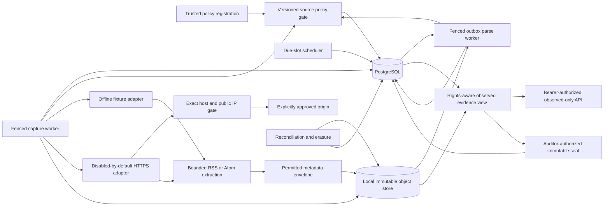
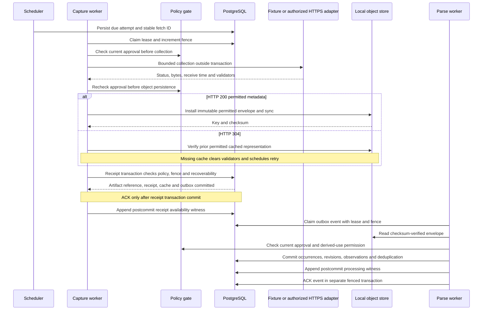

# M1 implemented architecture

Status: an offline, observed-only ingestion slice under engineering verification. This document
specifies the code in this feature branch; executed evidence belongs in
[M1_TEST_EVIDENCE.md](M1_TEST_EVIDENCE.md). It does not establish G0 rights approval, a live source
panel, production durability qualification, forecasting accuracy or editorial utility.

The design remains a Python modular monolith. PostgreSQL stores rights versions, attempts,
receipts, provenance, outbox state, availability witnesses and immutable observation manifests.
A local filesystem store holds only permitted metadata envelopes. PostgreSQL and filesystem
operations commit separately; compensation and reconciliation make that boundary explicit.
Original v0.1/v0.2 design documents remain unchanged.

## Modules and trust boundaries

| Module | Responsibility |
| --- | --- |
| `config.py`, `db.py` | Typed environment configuration, PostgreSQL-only engine and transaction helpers, database clock, common evidence advisory lock |
| `models.py`, `migrations/` | Durable evidence ledgers, operational registry/cache/lease state, uniqueness and append-only database guards |
| `policy.py` | Versioned approval registration, source head changes, effective/expiry checks, metadata and derived-use gates, revocation as a new version |
| `capture.py` | Bounded scheduler backlog, account/origin admission, capture fencing, retry/breaker state, receipt/cache/outbox transaction and compensation |
| `collection.py` | Trusted offline adapter, explicitly capability-gated HTTPS transport, bounded RSS/Atom metadata extraction and retry helpers |
| `objects.py` | Immutable local metadata files, SHA-256 verification, atomic conditional installation and filesystem sync |
| `worker.py` | At least once outbox claims, idempotent revision/observation effects, parser diagnostics, final fencing and separate acknowledgment |
| `availability.py` | Append a separate witness after durable receipt, parse effects or manifest commit; delay visibility safely when the witness is absent |
| `snapshots.py` | Current permitted evidence selection, explicit coverage states, current observation ordering and immutable observed-only seals |
| `reconcile.py` | Orphan deletion, missing/corrupt artifact detection, rights/retention erasure, append-only invalidation and missing witness recovery |
| `asgi.py`, `cli.py` | Configured Uvicorn entry point and trusted administration/offline worker commands |
| `api.py` | FastAPI health/readiness, authorized source and evidence reads, separate auditor capability for seals and replay |

The HTTPS adapter requires both an enabled live configuration and a matching explicit internal
`CollectionCapability`. The collector cannot approve its own source: the trusted policy gate
provides that value after checking the database. Default local operation uses `fixture://` and
synthetic bytes; fixture approval is not publisher permission. The API exposes no arbitrary URL
fetch route and no policy-registration route.

## Durable capture and processing

1. `schedule` persists an attempt with stable fetch ID, approval version, origin/account scope and
   due slot. A bounded pending count applies backpressure. One pending/leased attempt per source coalesces
   repeated polls, so a long Retry-After cannot fill the global backlog with one source. Approval failure creates policy-safe
   health evidence rather than contacting an origin.
2. `claim_capture` acquires eligible rows with `FOR UPDATE SKIP LOCKED`, increments the fence,
   sets a finite lease and consults the shared persisted origin budget. The current approval is
   checked before collection; expired, unknown, revoked and changed versions fail closed.
3. Collection occurs outside the database transaction. HTTP 429/503 update persisted Retry-After,
   exponential jitter and breaker state. Transport and XML rejection become explicit failures.
   Only supported permitted metadata survives transient `xml-metadata-v1` extraction;
   the receipt records that immutable transform version.
4. Rights are checked after collection and before the object put. A new envelope is stored using
   a key containing approval version, fetch ID/fence and byte checksum. The attempt records the payload retention deadline before the put; active lease protection
   never extends retention. File and directory sync
   precede installation acknowledgment. This write alone is an orphan, not captured evidence.
5. A receipt transaction serializes with policy changes using the shared evidence lock, checks
   the current lease/fence and approval, verifies recoverable object bytes and atomically commits
   artifact reference, receipt, source cache validators, parse-request outbox and capture state.
   Capture acknowledgment follows this commit. An unsuccessful acceptance compensates its own
   uncommitted object; a crash can leave an orphan for the reconciler.
6. Receipt availability is a separate postcommit witness. A crash before this witness delays
   operational eligibility; reconciliation can append the witness at the actual later recovery
   time. It cannot backdate availability.
7. The parser directly polls the transactional outbox. Claim state is operational and renewable
   through a new fence after expiry. Publication occurrences, content revisions, every receipt
   observation and consumer deduplication commit together. Final lease validation occurs inside
   the effects transaction. A committed effect followed by an acknowledgment crash is safely
   redelivered using `(consumer, event_id, version)` deduplication.
8. A separate parsed-receipt witness follows effects commit, then the event acknowledgment changes
   operational state to `DONE`. There is no external broker and no exactly once delivery claim.

A valid 304 creates its own receipt and observations while referring to an existing recoverable
permitted object. It does not infer availability from a validator string. Missing cache bytes
clear validators and persist a gap/retry; no usable receipt is fabricated.

## Evidence visibility and immutable seals

All evidence writers, rights/head changes, reconciliation and seal/read operations use the same
PostgreSQL transaction advisory lock. That lock is held through commit. Sequence allocation alone
is not a committed visibility boundary. The conservative lock serializes the small M1 evidence
path; production throughput and lock contention have not been qualified.

`recorded_at` is a database-clock insertion timestamp. It is not proof of transaction commit.
`availability_witnesses` are appended in a new transaction after the referenced entity/effects
commit and include a PostgreSQL visibility description. Operational evidence selection requires
committed receipt and parsed-receipt witnesses, still-permitted policy, valid retention and
checksum-verified artifact bytes.

`seal_snapshot` accepts a run identity and source selection, and seals the committed observed
state at the current database cutoff. It does not accept an arbitrary retrospective cutoff.
The immutable manifest freezes exact receipt/observation/revision IDs, checksums, source policy
panel, versions, source health/gaps, processing availability, receive order and first-seen values.
Publisher text, raw article URLs and publication claims are absent from manifest bytes; replay
loads permitted immutable revisions by ID. Reusing a run ID reuses its stored seal; an incompatible
source selection is a conflict. A postcommit snapshot witness remains outside the manifest.

Later revisions and late earlier receipts can change the current list and current derived
first-seen state. They do not rewrite an already sealed manifest or its original first-seen
value. Missing, expired or revoked content makes replay unavailable. Reconciliation appends
invalidation records and legally required erasure; it never silently repairs a historical seal.

These are observation primitives. Event/membership/family versions, feature artifacts, model
identities, forecasting issuance and label policies from the full v0.2 research manifest are not
implemented in M1.

## Degraded operations and access

Persisted health evidence distinguishes failed collection, rate limiting, parser rejection,
rights blocks, cache loss, expired leases and recovery uncertainty. Current API coverage uses
`AVAILABLE`, `HEALTHY_EMPTY`, `PARTIALLY_DEGRADED` and `EVIDENCE_UNAVAILABLE`. A successful HTTP
response with missing/unprocessed evidence cannot establish healthy empty coverage. Historical
gaps remain visible after later successful requests; any retained gap conservatively degrades
the response. Automatic completeness certification/gap closure is not implemented.

Read routes require a configured API bearer token. Sealing and replay require a separate audit
token; equal/missing credentials fail closed. `/health` is a minimal liveness endpoint; readiness
checks PostgreSQL and migration heads. This is a single operator deployment boundary, not a
multi-tenant identity or authorization system.

## Security and qualification limits

The live transport verifies exact HTTPS host, port 443, absence of credentials/fragments, all
resolved IPv4/IPv6 destinations and the pinned connection address. It verifies TLS against the
original approved hostname, follows no redirects and accepts no compressed representation.
DNS uses a killable resolver subprocess; a whole-request deadline interrupts stalled I/O. The capability lifetime is bounded by both
policy expiry and the capture lease, and is rechecked after DNS and TLS context setup.
Conditional validators, response headers/body and request time are bounded.

XML extraction uses `defusedxml` with DTD/entities/external access disabled and requires
RSS items under exactly one direct channel. It applies limits over
encoded bytes, total elements, depth, items, retained/discarded text and elapsed work. No article
or entity URLs are fetched. Hard parser CPU/address-space isolation and deployment egress policy
are separate deployment controls, not established by these in-process checks. Trusted fixture
callbacks are test infrastructure; their timeout is detected after return, not a Python sandbox.

The local object store assumes a trusted private directory and honest filesystem/database
operators. Independent collector/parser execution is possible, but OS-enforced process isolation,
production account permissions, sustained capacity/fairness measurements, live origin/TLS/DNS
qualification, WAL/PITR restore and a deletion-log-aware production backup strategy remain
unqualified. See [M1_OPEN_ISSUES.md](M1_OPEN_ISSUES.md) and the executed test evidence.
