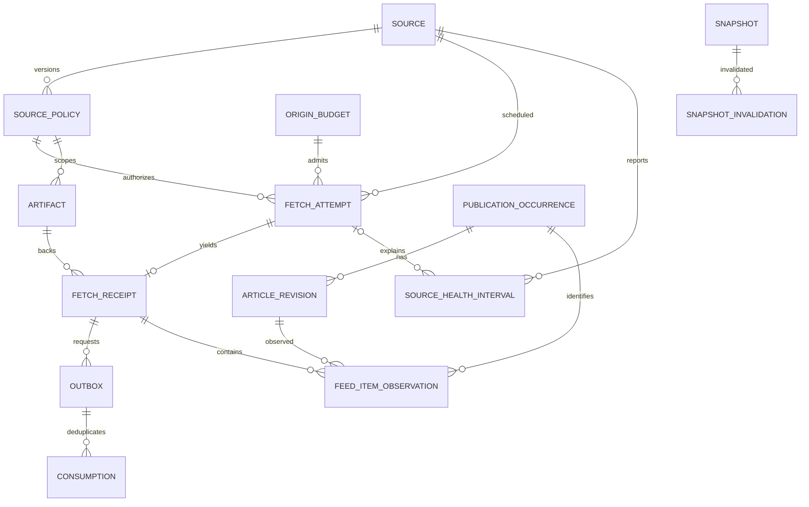

# M1 implemented data model

The Alembic schema and `src/pulse/models.py` implement the observed-only slice below. PostgreSQL is
required for transaction, lock, lease and visibility semantics. SQLite is not an acceptance
substitute. Migration and fault-test results are recorded in
[M1_TEST_EVIDENCE.md](M1_TEST_EVIDENCE.md).

## Evidence ledgers and operational state

| Table | Purpose and identity | Mutability |
| --- | --- | --- |
| `sources` | Source ID, unique feed ID, current approval head, due slot and conditional cache state | Operational head/cache fields change; registration preserves feed identity |
| `source_policies` | Immutable source approval version, publisher/owner identity, endpoint/scope, effective interval, actor, permitted fields, retention, rate scope and collection budgets | Append only; unique `(source_id, version)` |
| `origin_budgets` | Account/origin rate-scope ID, next allowed time, consecutive failures, breaker/probe state | Operational |
| `fetch_attempts` | Stable fetch ID, approved policy, due/schedule slot, retries, payload retention deadline, current lease and monotonically incremented fence | Operational; unique `(source_id, schedule_key)` |
| `artifacts` | Local immutable object key, approval version, SHA-256, byte size, creation and expiry | Append-only metadata; bytes may be erased separately |
| `fetch_receipts` | One accepted result per fetch ID, source/policy/artifact reference, status, receive/record time and schema/extraction/clock provenance | Append only; fetch ID unique |
| `outbox` | Versioned parse-request event linked to receipt; claim/lease/fence/due/error/ACK state | Operational; unique `(topic, receipt_id, version)` |
| `consumptions` | Idempotent logical processing witness | Append only; primary key `(consumer, event_id, version)` |
| `publication_occurrences` | Publisher-scoped publication identity and algorithm/confidence | Append only; unique `(publisher_id, identity_key, identity_version)` |
| `article_revisions` | Exact permitted metadata content fingerprint and parser/normalization/schema versions | Append only, subject to explicit erasure; unique occurrence/fingerprint/version tuple |
| `feed_item_observations` | Every accepted item ordinal links a receipt to occurrence and revision, preserving feed/receive/record provenance | Append only, subject to explicit erasure; unique `(receipt_id, ordinal, parser_version)` |
| `availability_witnesses` | Postcommit observation of receipt, parsed-receipt or snapshot availability, with PostgreSQL visibility description | Append only; unique `(kind, entity_id)` |
| `source_health_intervals` | Immutable successful/degraded/missingness intervals, causes and policy-safe diagnostics | Append only |
| `snapshots` | Observed-only cutoff, panel hash, logical run identity, canonical manifest bytes and SHA-256 | Append only |
| `snapshot_invalidations` | Later rights, retention or artifact-loss invalidation of an existing seal | Append only; unique `(snapshot_id, reason, reference_id)` |
| `audit_events` | Non-content registration, reconciliation, erasure and recovery trace | Append only |

Append-only trigger guards reject update/delete on evidence tables. The erasure path sets a
transaction-local guard permitting deletion of only revisions and observations, removes required
content and appends allowed audit/invalidation traces. A database owner can bypass administrative
controls; production roles and tamper-resistant audit qualification are outside this local slice.



`availability_witnesses` references three entity kinds through `(kind, entity_id)`, validated by
application code rather than a polymorphic foreign key. Snapshot dependencies are canonical JSON
references frozen in the manifest, not join-table foreign keys. Registry head and cache fields
are operational pointers; code validates their policy and recoverability before use.

## Four identities remain distinct

A feed delivery is a receipt. Each accepted item within that delivery is a separate observation,
identified by receipt, ordinal and parser version. The same item in two deliveries creates two
observations, including HTTP 304 deliveries with valid cached bytes.

A publication occurrence is scoped to a publisher. `occurrence-v2` uses a stripped opaque GUID
where available, otherwise a conservatively normalized URL. Publication time, precision and title
are revision attributes, never independent story identity. The raw permitted fields remain on the
revision. GUID reuse and URL-only identities carry explicit ambiguity rather than pretending a
publisher date or URL uniquely identifies a news development.
Different publishers syndicating identical metadata create different publication occurrences.

The receipt records the fixed XML extraction transform `xml-metadata-v1`. A revision records
the exact permitted metadata fingerprint within an occurrence, plus
`parser-v1`, `normalization-v2` and `metadata-envelope-v1`. The normalization version includes
identity resolution; already committed `normalization-v1` records remain unchanged. Identical A
bytes can reuse a revision ID after B, while all three receipt observations preserve A → B → A
order. A title edit
is a new revision within the same defensible occurrence identity. Reusing a URL with a distinct
GUID is a separate occurrence. Changing a publication claim alone appends a revision. Reusing a
GUID or URL without stronger publisher identity evidence cannot be
disambiguated from an edit without additional licensed evidence; that limitation is explicit.

The v1 timestamp-derived key is retained only on historical rows. Future observations can continue
a unique currently permitted, retained legacy occurrence; an append-only audit reference records
that v2 resolution. The chosen legacy evidence must remain authorized and retained through the
final commit check, including when it belongs to another source at the same publisher.
A matching URL may narrow GUID-reuse candidates. Multiple compatible legacy
occurrences are quarantined as `publication_identity_ambiguous`, with candidate IDs in audit and
receipt rejection evidence. Historical IDs are never merged or reassigned and old seals are not
resealed. Pending `parser-v1` outbox requests remain processable under the new normalization
transform; already consumed requests remain idempotent.

There is no inferred content-family, independent reporting origin or news-event table in M1.
Content equality does not establish those identities.

## Permitted metadata objects

Raw RSS/Atom bytes exist transiently within collection/parsing limits. Durable local objects are
canonical JSON envelopes containing `schema_version` and `items`. Supported fields are GUID,
article URL, title, raw publisher publication claim and precision. Each policy selects a subset;
full text and descriptions are discarded. Deriving revisions also requires `derived_allowed`.
Training is rejected as outside M1.

The local key format is:

```text
<policy-id>/<fetch-id>-<fence>/<sha256>.json
```

Object installation and PostgreSQL receipt commit are separate. The artifact reference is
accepted only after checksum verification and current-policy/fence validation. An unreferenced
file is an orphan, including interrupted `.put-` staging files. An active lease protects
only its exact current fence and still-permitted payload deadline. Retention is anchored to
response `received_at`, not extended by upload, retries or object reuse. Reconciliation avoids active allowed capture writes, removes disallowed or
abandoned orphans, clears invalid validators and explicitly invalidates affected seals when
committed artifacts are unavailable. A 304 references the previous recoverable permitted
artifact; cache absence requires an unconditional retry rather than an accepted unchanged feed.

Allowed fields govern storage; link-display permission independently controls URL display in
API records. Current reads require a matching active policy, retained artifact and committed
availability witnesses. Replacing the source approval version clears validators and makes old
version content unavailable until the explicit retention/erasure path resolves it.

## Temporal meaning and ordering

| Field | Meaning | Operational availability consequence |
| --- | --- | --- |
| `published_at`, raw publisher field and precision | Publisher claim interpreted only with explicit timezone/precision support | Never establishes historical availability |
| `received_at` | Collector response evidence time; repeated on each item observation | Preserves receipt chronology; clock quality remains explicit |
| `recorded_at` | Database-clock insertion time within receipt/effects transaction | Not a transaction commit witness |
| `postcommit_observed_at` | A later transaction observed already committed receipt/effects/seal | Eligibility requires that witness itself to be committed |
| Derived `first_seen_at` | Earliest receive time among currently qualifying observed receipt history for an occurrence | A current late receipt can restate it; a sealed value never changes |
| Snapshot `cutoff_at` | Current database cutoff at sealing while the common evidence lock is held | No caller-supplied retrospective cutoff is accepted |
| Artifact/policy expiry | Retention and effective approval boundaries | Expired content is unavailable; erasure and invalidation follow |

All persisted times use timezone-aware PostgreSQL timestamps. Publisher date-only or unknown
zone claims are retained as raw permitted metadata but do not invent a precise UTC timestamp.
The collector/database clock relationship is not operationally qualified; receipts carry clock
quality metadata. Out-of-order processing does not replace source chronology with parse order.

Postcommit witnesses deliberately occur after entity/effect commit. An interrupted witness write
cannot make an uncommitted entity eligible. Recovery creates a later witness, never a backdated
one. The witness ID alone is not commit proof: snapshots take the common evidence lock, enumerate
committed witnesses and persist the PostgreSQL visibility description and availability boundary.

## Observed-only manifest contract

A seal stores canonical bytes and SHA-256, source/policy panel and its hash, exact qualifying
receipt and observation identities, revisions/checksums, version identities, receive/record and
processing availability times, frozen first-seen values, current observation IDs, health/gaps and
queue state. It excludes publisher payload fields so deletion does not require rewriting its
bytes. A separate snapshot availability witness follows seal commit.

The schema's logical uniqueness tuple is `(run_id, panel_hash, cutoff_at,
candidate_policy_version, kind)`. The application treats a run ID as an idempotent seal request:
repeated requests reuse its committed manifest and incompatible source selections conflict.
Historical replay reads the original IDs and frozen first-seen values, with current rights,
retention and artifact checks. Later evidence can change current observations but not sealed
manifest bytes/hash. Invalidation records remain outside the hash and can make replay unavailable.

This is `OBSERVED_ONLY`; there are no forecasts, artificial historical issuances, event
recommendations or full research-feature manifests. See
[M1_OPEN_ISSUES.md](M1_OPEN_ISSUES.md) for unresolved scope/identity decisions and
[M1_ARCHITECTURE.md](M1_ARCHITECTURE.md) for transaction and failure boundaries.
