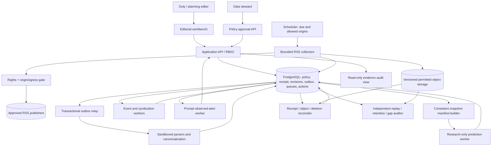
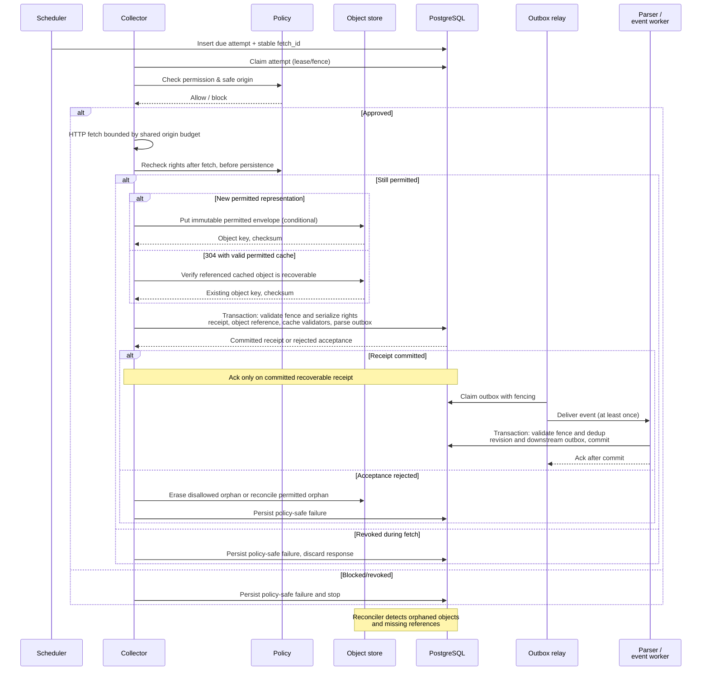

# Architecture, failure boundaries and recovery — v0.2

**Status:** prescriptive design; not implemented. Preserve modular monolith ADR-001. Workloads may run as independently resource-bounded processes while sharing source and domain contracts.

## C4-style container and trust boundaries

**Separation:** No direct collector-to-clustering delivery. All work transitions persist in PostgreSQL. Forecasting never gates the observed alert stream. LLM text interpretation, if enabled, runs without database-write privileges, secrets, or network tools; schema/evidence IDs are validated by a trusted process. No automatic publishing or opinion manipulation.

## Transaction boundary contract

1. **Preflight**: approve origin/permission *before* any network request; persist a due `fetch_attempt` and stable `fetch_id`. Permission is checked again before accepting durable content.
2. **Fetch**: use bounded network/parse budgets. Recheck current permission after the response and before any object persistence. Store the allowed raw representation or policy-permitted metadata envelope as a content-addressed, policy-scoped, immutable object. An unapproved payload must not remain in quarantine. A valid 304 references the existing permitted, recoverable object; it creates a receipt without inventing new publication occurrences.
3. **Receipt transaction**: in one PostgreSQL transaction, verify the current lease/fence and serialize the approval-version check with revocation; commit `fetch_receipt`, artifact reference, the origin cache/validator update (only if recoverable), and a `parse_requested` outbox entry. ACK only after this transaction commits. If permission changed during the object put, reject acceptance and erase the now-disallowed object under the deletion contract. A prior object-only write is *orphaned*, not acknowledged capture.
4. **Revision transaction**: parse workers perform idempotent receipt processing. In one transaction, commit content revision, origin/occurrence provenance and `event_resolution_requested` outbox event.
5. **Outbox**: relay delivers at least once; consumers deduplicate by `(consumer, logical_event_id, version)`. Validate the current lease/fence inside the same transaction as every worker's effects and deduplication record; a check made only when claiming work is insufficient. No exactly-once network delivery claim.
6. **Reconcile**: scan unfinished attempts, orphaned objects, missing referenced objects, undelivered outbox work, and invalidated/deleted records. Audit all exception intervals.

## Failure matrix and recovery invariants

| Crash point | Expected recovery | Prohibited outcome |
|---|---|---|
| Before permitted object put | Retry due attempt if still authorized | Silent success |
| After put, before DB commit | Object is orphan; re-fetch/reconcile or expire within retention policy | Claimed captured article without DB reference |
| After receipt DB commit, before relay | Outbox worker resumes | Permanent unprocessed receipt |
| After worker DB commit, before ack | Idempotent redelivery | Duplicate revision/member/publisher count |
| 304 after cache object deleted | Invalidate validator, perform authorized unconditional fetch; mark gap if impossible | Claim usable unchanged representation |
| Restart during origin throttle | Persisted next_allowed_at still enforced | Thundering herd |
| Backup restore with missing objects | Reconcile and invalidate impacted cutoff windows | False PASS after partial restoration |

**Capture durability SLO** is defined by committed acknowledgments, not network response alone. Design target: **no silently lost acknowledged capture**; any unrecoverable receipt causes explicit invalidation of impacted snapshots. Define quantitative RPO/RTO only after testing WAL-backed point-in-time restore with matching immutable object versions and deletion records. The prior 24-hour metadata RPO is superseded, not accepted.

## Worker control and degraded history

Persist `origin_budget` keyed to provider-enforced scope (origin/account where known): next_allowed_at, retry budget, breaker state, failure category. Support both RFC-compliant Retry-After delay and HTTP-date, bounded exponential jitter, half-open probing, capped in-flight requests, and no IP/proxy evasion. Isolate collector, parser, event, snapshot, and inference CPU/connection pools. 429/503, timeouts, malformed data and rights revocation have distinct transitions. Stale successful feeds and large parser rejection rates are **DEGRADED**.

Record immutable `source_health_interval` including fetch freshness, original publication-to-receipt latency estimate (publisher timestamp caveats), parse/revision lag, missingness/rollover risk and downstream queue lag. A healthy later request **must not clear a historical gap**. Recovery bursts require warm-up exclusion and cannot be called organic article growth without evidence.

## Data and scaling

Write one lightweight receipt per valid fetch, but do not rewrite article revisions, syndication memberships or event features for unchanged bytes. A→B→A still yields three chronological *observations*, even where payload A is reused by checksum. Keep volatile queue state apart from immutable evidence. Monitor pending age, drain time, WAL bytes, DB contention, bloat, source lag and manifest latency. Consider partitioning and brokers only on measured thresholds; preserve uniqueness across partitions.

## Security boundaries

SSRF: allowlisted scheme/host/port, resolved IPv4/IPv6 destination checks, every redirect, pinned validated connection destination, deny-by-default network egress; apply to previews and article links. XML: disable DTD/entities; bound encoded/decompressed bytes, nesting, items, text, wall and CPU time and memory. LLM: untrusted text remains data; privileged trusted code validates output structure/citations, with zero credential or network privilege in summarization workers. Tenant separation and retention/deletion tests are release gates.

See [DATA_CONTRACTS.md](DATA_CONTRACTS.md), [DELIVERY_AND_VERIFICATION.md](DELIVERY_AND_VERIFICATION.md).
