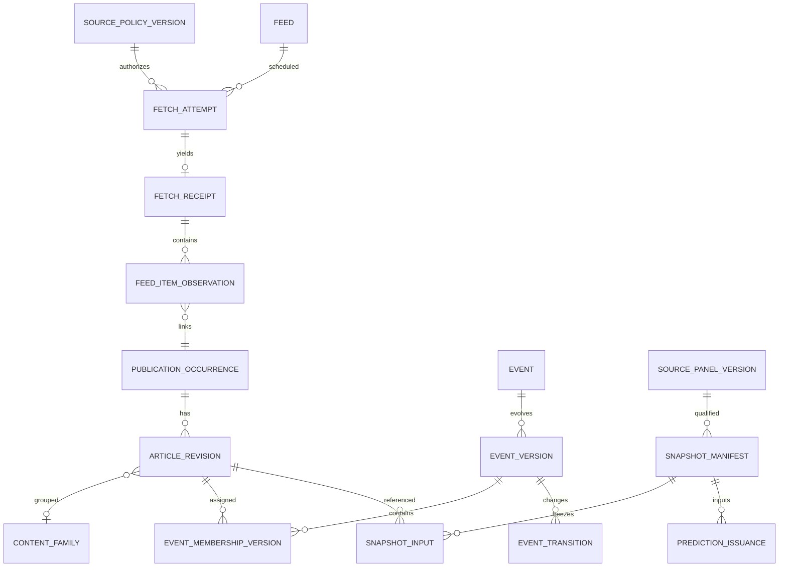

# Data, identity, availability and event-resolution contracts — v0.2

**Normative for proposed implementation, not verified in a running system.**

## Eligible panel and rights

Every `source_manifest_version` MUST include effective approval interval, controlling owner ID, publication brand ID, original feed endpoint and access scope, retention/derived-data/training/link-display restrictions, attribution, polling and retry conditions, timestamp quality, expected feed rollover, allowed payload fields, approval actor, approval timestamp and revocation/deletion procedure. Check legal permission *before request* and at persistence. Unknown rights = BLOCKED. No full-text retention/model training by default. No substitution of government bulletins, mirrors or related brands to satisfy an independence gate. Panel version is immutable; additions constitute a new panel with separate study identity. Minimum three controlling owners is smoke eligibility only, not representativeness.

## Entity identities (do not collapse)

**Four different identity scopes:** (1) feed item GUID/URL observed in an individual feed, (2) publisher publication occurrence, (3) content or syndication family and original reporting lineage where known, (4) event/development. URL aliases and normalization algorithm version are preserved. Same syndicated story across publishers counts as separate occurrences for **distribution breadth**, but not independent origin content. Reused URL does not imply same revision/event. Publication edits append revisions; never overwrite old content. Deduplication keys must be versioned per source; `(feed_id, canonical_url_hash)` alone is insufficient.

## Time contract

| Time | Meaning | May establish historical availability? |
|---|---|---|
| `published_at` | Publisher claim, precision/timezone/confidence stored | NO |
| `received_at` | Network response evidence arrived at collector | Not sufficient alone |
| `recorded_at` | Durable receipt/revision event committed; persist observation order/commit witness | Candidate availability, only when operationally usable |
| `processing_available_at` | Derived state published for operational use | YES when included in committed snapshot |
| `effective_at` | A corrected fact's domain time | NEVER alone |
| `label_available_at` | Future outcome became complete and final for training | YES for model training only |
| `snapshot_issued_at` | Frozen forecast issued with exact candidate/transform/artifact identities | Authoritative operational prediction |

Transaction start timestamp is not proof of commit visibility. Use a committed consistent DB view to enumerate actual usable inputs and freeze exact IDs/checksums in a manifest, followed by issuance without later reopening. A `snapshot_manifest` MUST include source panel version, health intervals, full candidate set (including unsuccessful candidates), permitted receipt/article revision IDs, event versions, membership versions, content-family rules, IDF/index/entity-alias versions, feature schema and implementation hashes, model/calibration identity, logical cutoff, snapshot build/commit/issuance timestamps, processing-lag state, and invalidation flags. A retrospective reconstruction is **not** evidence of a prediction actually issued at the historical cutoff.

## Logical uniqueness, immutability and races

Logical snapshot key: `(experiment_id, panel_version, cutoff_at, candidate_policy_version, snapshot_kind)`. A second attempt with a different manifest hash at that same logical key is **a determinism conflict requiring audit**, not an accepted additional historical version. If a legitimate rerun uses altered code/transforms, it gets a new experiment/run family and explicit relationship. `PREDICTION_ISSUANCE` references exactly one frozen snapshot and model version.

Event transitions use compare-and-swap `expected_predecessor_version`, transition ID, actor/model/reason and recorded time. Merge and split create lineage links and reversible review actions; remove memberships through new versions instead of deleting history. Closed events can reopen only through an explicit new-development transition; collector outage alone must not cause inactivity closure.

`first_seen_at` is **derived from immutable qualifying receipt history**, not a mutable timestamp column corrected in place. Out-of-order receipts may change the *current* earliest justified observation, but released snapshots must remain untouched and any restatement gets an explicit version/audit record. A→B→A captures all three observed chronological states even if payload A is content-address-reused.

## Prefix invariance

For any issued cutoff `t`, capture original manifest and emitted outputs. Then append future receipts, edited headlines, alias updates, clustering merges/splits and parser upgrades. Re-verify that the original manifest, ranking, evidence and hash are byte-identical. If they differ, block release and investigate; do not silently repair historical predictions. Parser/schema/normalizer, alias tables and retrieval indexes are immutable or version-addressed inputs.

## Event granularity and resolution benchmark

An event represents a **specific action/development** with actors, location and relevant time, not a broad theme; a parent story may link multiple separate developments (announcement vs reversal). Benchmark lexical TF-IDF/character n-grams, Arabic morphological features, embeddings and hybrid systems on **permitted stored fields only**. Annotate chronological Arabic examples with variants, transliterations, near-identical official announcements, paraphrases, repeated headline templates, syndicated wire, evolving incidents and distinct developments. Preserve Arabic originals. Hold out content families and evaluate false merges, fragmentation, pairwise P/R, origin attribution and the downstream proportion of label flips/top-five changes. Predefine sampling, adjudication disagreement and thresholds before gate G2.

## Rights revocation / deletion

Revocation stops new access immediately and blocks acceptance of in-flight fetched content. Delete or expire disallowed artifacts, embeddings and derivative displays as required; retain only policy-permitted non-content audit traces. Enumerate impacted manifests and mark research outputs INVALIDATED rather than quietly recomputing missing historical evidence. Handle legal holds only on explicit authorized basis.

## Health and publication completeness

`OK`, `NO_CHANGE_VALID_CACHE`, `STALE`, `PARSER_DEGRADED`, `RATE_LIMITED`, `UNAVAILABLE`, `RIGHTS_BLOCKED`, `OWNER_UNVERIFIED`, `RECOVERY_UNCERTAIN` are distinct states. `304` is usable only when corresponding cached representation is durably recoverable. Poll success is not feed completeness. Persist missing intervals; distinguish unknown vs observed zero; recovered bursts may be measurement artifacts.

See [ARCHITECTURE.md](ARCHITECTURE.md), [FORECASTING_PROTOCOL.md](FORECASTING_PROTOCOL.md).