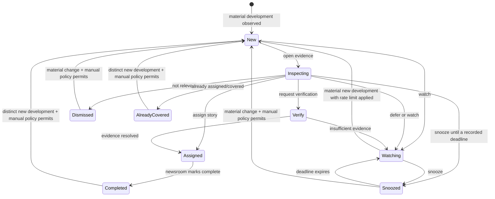

# Editorial product contract v0.2

**Primary product hypothesis:** identify which relevant developments deserve an editor's reporting decision, and help avoid redundant rewrites. This is not necessarily the five most-covered or most-clicked stories. Non-coverage decisions can be valuable.

## Two operational cadences

1. **Observed evidence lane:** event change notifications soon after qualified capture and processing; continuously updated within lawful collector bounds. Not paced by the six-hour forecast research schedule. Displays health degradation, unverified facts and coverage lineage.
2. **Predictive research lane:** experimental 24-hour target at six-hour cutoffs. Probability fields remain absent/null and must not drive newsroom actions until independently qualified and authorized for deployment.

## Duty editor workflow



**First view:** what changed / when first observed / desk relevance / current sources and owner distribution / original reporting diversity where known / conflicting evidence / whether already assigned / source health. **Evidence view:** permitted excerpts or metadata only, links (when allowed), chronology, aliases and syndication graph, disputed/unknown claims and rights attribution. **Action view:** verify, assign, watch, snooze, dismiss, already covered; all actions have actor/time, idempotent requests, shared tenancy permissions.

Use **up to five**, including zero when no eligible material changes, and never invent filler. Suppress unchanged repeats while preserving material new developments; do not continuously reshuffle the editor's reading position. Forecast scores are secondary and hidden when unqualified. Technical hashes/calibration appear in audit details, not the live headline card.

## Data-quality/API states

Operating `mode` and `evidence_status` are independent fields. `mode` is `OBSERVED_ONLY` or `FORECAST_QUALIFIED`; `evidence_status` is `AVAILABLE`, `NO_QUALIFIED_CANDIDATES`, `PARTIALLY_DEGRADED` or `EVIDENCE_UNAVAILABLE`. `panel_health` reports source health separately. Apply evidence status in this order: no usable permitted evidence → EVIDENCE_UNAVAILABLE; any relevant gap with usable evidence → PARTIALLY_DEGRADED; complete healthy evidence with no eligible material developments → NO_QUALIFIED_CANDIDATES; otherwise AVAILABLE. A known positive observation may remain visible during partial degradation; it does not establish the absence of other news.

| State | When | Editor sees |
|---|---|---|
| `AVAILABLE` + `OBSERVED_ONLY` | Permitted observations exist; forecast not released | Dated evidence cards, explicit monitoring scope |
| `NO_QUALIFIED_CANDIDATES` | Healthy authorized panel; no event meets editorial criteria | True empty briefing with last successful checkpoint |
| `PARTIALLY_DEGRADED` | Some source/processing gaps, permitted observations remain | Evidence from qualified sources plus conspicuous gap indicators; no unsupported forecast |
| `EVIDENCE_UNAVAILABLE` | No lawful/usable evidence for request or revoked panel | No candidates, explicit cause and temporal scope |
| `AVAILABLE` + `FORECAST_QUALIFIED` | Forecast released after G5 plus current health checks | Evidence cards with calibrated forecast and model/date context |

Never interpret `candidates:[]` alone as no news. Forecast null is a genuine state, not 0% probability.

For NO_QUALIFIED_CANDIDATES, require healthy/complete authorized evidence and a last successful checkpoint. EVIDENCE_UNAVAILABLE returns an empty candidate list with a reason and affected interval. PARTIALLY_DEGRADED includes explicit gap records, even when the qualified subset yields zero candidates. Only AVAILABLE with a released, currently usable frozen forecast may set mode=FORECAST_QUALIFIED and forecasts_available=true. All other combinations use OBSERVED_ONLY, forecasts_available=false and absent/null probability fields. Research scores remain in the restricted audit lane until G5; public observed endpoints must not expose them. Tenant/rights filtering is applied before determining status for the request.

### Illustrative contract — not a runtime result

```json
{
  "mode": "OBSERVED_ONLY",
  "evidence_status": "NO_QUALIFIED_CANDIDATES",
  "as_of": "2026-10-12T15:00:00Z",
  "panel_version": "illustrative-panel-v1",
  "coverage_scope": "authorized_enrolled_publishers_only",
  "panel_health": "OK",
  "forecasts_available": false,
  "candidates": [],
  "reason": "illustrative_no_material_development",
  "last_successful_checkpoint_at": "2026-10-12T15:00:00Z",
  "observation_age_seconds": 0,
  "source_gaps": []
}
```

API boundaries: `GET /v1/briefings/observed`, `GET /v1/events/{id}/evidence`, `POST /v1/editorial-actions` (idempotency key, actor, event-version precondition), `GET /v1/source-health`, and auditor-only `GET /v1/snapshots/{id}/manifest`. Proposal only: no server is deployed. Tenant-aware access control applies to every event/action.

## Measuring newsroom utility without manufactured feedback

Design a blinded, timed scenario study from **real rights-qualified source observations**, plus qualified proxy evaluators when actual newsroom editors are unavailable; state external-validity limitations. Compare (1) RSS reader with simple momentum ordering, (2) correctly configured commercial tool using its native data coverage where access permits, and (3) PULSE. Run both **identical evidence** comparison (ranking/UI value) and separately **native feed coverage** comparison (purchase/real-world value); do not pretend the data are equal in the latter.

Predeclare tasks and rubrics for a busy shift and quiet shift. Capture accuracy of identified changes, verification/assignment decisions, time to triage, unique actionable developments, interruptions, duplicate assignments, missed important events and evidence inspection effort. Attribute “earlier” to the editorial decision deadline or incumbent newsroom discovery, not just to future label maturation. No simulated customer quote, willingness-to-pay assertion, or invented performance.

Explicit decision rule: If monitoring helps but predictions do not, keep a monitoring product. If PULSE cannot add benefit over accessible tools after realistic costs (data licensing, annotation, source negotiations, support), consider KILL or pivot. Public-opinion influence/manipulation and individual political profiling remain out of scope.
