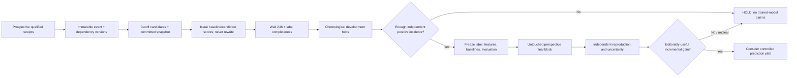

# Forecasting research protocol v0.2 (parameters must be frozen before any final test)

**Outcome:** growth in **newly first-observed eligible publisher-panel publication occurrences** for an already known, resolved event in the next 24 hours. This is NOT audience interest, approval, opinion, future event occurrence, or independent factual corroboration.

## Target and eligibility

At logical cutoff `t`, consider all events known and operationally usable by `t` that satisfy a **preregistered** event-age interval, recent-activity requirement, beat policy, source-panel health and event-resolution confidence. Freeze *all* eligible candidate IDs for issuance, including later non-events, not just successful future stories. Record actual issuance separately as required by DATA_CONTRACTS. Events repeatedly considered at six-hour cutoffs count as related observations; store incident lineage.

Each publication occurrence counts once by its immutable qualifying first-observation history (`received_at` with durable receipt evidence); repeated feed appearances, edits and 304 responses add no occurrences. Freeze the historical count and event anchors from state available at `t`. Late receipts or identity restatements that would change that count make the comparison unscorable through an append-only invalidation, rather than rewriting it. Let `N_past(e,t)` count eligible occurrences in `(t-24h,t]`; `N_future(e,t)` count eligible occurrences in `(t,t+24h]` matched by frozen outcome matching; `B_future(e,t)` count distinct controlling publisher owners with future eligible occurrences. Owner identity is resolved from the frozen panel version; related brands never add owners. Let `D = N_future - N_past`.

**Primary candidate label:** `Y=1` iff `N_future >= n_min`, `D >= delta_min`, and `B_future >= b_min`, with comparison operators (inclusive), count precision, exact windows and owner rules frozen. An additional relative growth threshold can be explored only on development data with a defined near-zero denominator. A high-future-volume-only outcome must be named `HIGH_FUTURE_COVERAGE` instead of surge. Do not assume a high quantile yields enough positives; report observed prevalence and power before deciding if this target is feasible.

`n_min`, `delta_min` and `b_min` MUST be positive integers; `delta_min >= 1` is a semantic requirement for growth, not an empirically chosen release threshold. `b_min` cannot exceed the frozen eligible controlling-owner count. Scorable complete windows that fail any label predicate receive `Y=0`; incomplete/invalidated windows receive no label, never zero.

**Tunable-on-development-only items:** event age and inactivity, already-large event treatment, candidate filtering, thresholds `n_min/delta_min/b_min`, whether quantile constraint is meaningful, time-of-day/beat stratification and fallback, healthy-owner count, wire-copy distribution vs distinct origin rules, and episode deduplication. Once frozen, no changes based on sealed final results. If small panel breadth makes positive events vanishingly rare, HOLD; don't weaken the label after opening the test.

**Labels:** both past and future windows must satisfy the frozen panel completeness policy. An observed zero is different from missing feed coverage. Health gating must detect feed rollover and recovered-item bursts. An outage window is UNAVAILABLE; retain only permitted issued artifacts and disclose unscorable bias. Define and freeze the future matcher at `t`, including prior event anchors, lexical/semantic index version, thresholds, tie-breaking, event granularity and competing assignments. It assigns future occurrences to the frozen candidate identities independently of later live merges/splits. Never rebuild past event definitions using later knowledge. Finalize a label only after the entire future window and all qualifying processing/completeness evidence have matured; subsequent invalidation withdraws eligibility without silently changing that label.

## Availability and temporal controls

Every model fitting at wall time `S` may use a row with logical cutoff `t` **only if** `t+24h <= S`, `snapshot_issued_at(t) <= S`, AND `label_available_at(t) <= S`, and the row has not been invalidated. Apply to preprocessing, target thresholds, feature selection, baseline fitting and calibration. Record actual clock cutoff, commit/availability witnesses, versioned transforms, indexed aliases, candidates and artifact checksums. Do not treat a published date or delayed archive import as as-of evidence.

Use chronological rolling **development origins** to select target, baseline family, model class and hyperparameters. Keep all events from the same cutoff together and respect label maturation across the boundary. No generic `TimeSeriesSplit(gap=4)` row trick. Compare only the same eligible candidate set and same source health for paired methods. Reserve a contiguous untouched final period **after** procedure freeze; 56 days is a candidate size, not guaranteed adequate statistical power. If opened during development, discard it and collect a new final period.

## Models and reference family

- **M0:** random (seeded) ranking, fixed-beat/theme ranking, prevalence-only probabilities separately.
- **M1:** event momentum and recent-volume/persistence.
- **M2:** owner distribution breadth, growth, event age and calendar/beat comparators, with deterministic tie-breaking and explicit zero handling.
- **M3:** regularized logistic regression using a small preregistered feature set, with training-fold-only preprocessing and temporally later development calibration. More complex ML allowed only if justified by measured sample size/benefit.
- **M4:** separate approved attention signals on **identical matched eligible observations**; if attention is the outcome, separate estimand, protocol and held-out evaluation.

Compare M3 against a precommitted selected baseline or a preregistered simultaneous family comparison; no cherry-picking from final results. Never use LLM narrative as an alternative to measured forecasting.

## Evaluation reporting contract

Primary research ranking metric: **Precision@up-to-5 per issuance cutoff**, with denominators, missing slot convention, number of candidate rows, prevalence and attainable ceiling; report actual occupied slots separately. Secondary: average precision with explicit convention; recall only where positives exist; unique positive incidents first alerted; first-alert lead time from actual issuance against **actual threshold crossing**; false alerts per day, repeated-alert burden, time-to-first-detection, per-beat and per-event-age slices, unscorable windows, and source health. For a positive label, threshold crossing is the earliest time in `(t,t+24h]` that cumulative matched future occurrences satisfy all three frozen count/growth/breadth predicates using the fixed past count; it is distinct from label finalization at/after `t+24h`. Negative lead time from a late issuance is reported as already crossed. Do not count repeated alerts for a single unchanged incident as repeated successful discoveries.

Probability quality: Brier and log loss relative to a frozen training-prevalence baseline; reliability diagrams with counts and uncertainty, especially in operating alert ranges. Brier alone is not proof of calibration. Fit recalibrator on temporally separated development data; no post-hoc calibration on final test.

Uncertainty: paired contiguous temporal block resampling preserving all cutoff candidates and both model predictions. Choose primary block size from **development-only** dependence/incident length analyses; assess prespecified alternate block sizes and leave-one-major-incident-out sensitivity. A 56-day holdout has few independent weeks no matter how many bootstrap draws. If independent incident counts/power insufficient, return HOLD, not a precise confidence interval.

Negative controls: future-prefix invariance; timestamp-shift leakage canary; label permutations within preregistered temporal blocks; independent counts and snapshot hash reproduction. Separate operational restoration from retrospective replay of bytes; only real issued forecasts establish operational predictive lead time.

## Forecast release

Forecasting GO requires (a) G0–G3 qualified, (b) enough stable mature positive incidents and clean candidate denominators, (c) baseline lift meeting a prespecified *practical* minimum with a paired uncertainty bound, (d) acceptable false-alert and repeat burden, (e) probability reliability in alert range, and (f) a measured editorial incremental benefit. If any is absent, retain OBSERVED_ONLY or HOLD. There are currently **zero evaluated real forecasts** from Phase 1–1C as reported; no numerical claim is supplied here.
